# AI News Intelligence System

**AI News Intelligence System genera informes de inteligencia sobre noticias de IA.** El usuario pide un tema por una API REST asíncrona (FastAPI). La API encola el pedido y responde al instante con un `job_id`. En segundo plano, un grafo de agentes (LangGraph) coordinado por un **Supervisor** resuelve la tarea en varios pasos:

- el **Investigador** usa como herramienta un **RAG híbrido** sobre una base documental (Chroma + BM25, fusionados con RRF y con filtros por metadatos);
- el **Analista** evalúa el sentimiento de las noticias encontradas;
- el **Redactor** escribe un informe con **citas verificadas** contra las noticias recuperadas.

Si la búsqueda no alcanza, el Supervisor refina. Si el informe es crítico, el grafo **se pausa para aprobación humana** antes de publicarlo. Redis guarda el estado de los jobs, un stream de eventos (seguible en vivo por SSE) y los **checkpoints de LangGraph**, así que un job pausado sobrevive a un reinicio del servidor. Cada ejecución queda trazada en **LangSmith**, con su árbol de pasos, tokens y costo. Todo el código es `async/await` y está validado con Pydantic. El sistema se levanta con un comando (`docker compose up --build`).

> Proyecto final del curso AI Engineering (Coderhouse). Integra los Módulos 1 a 7: cliente LLM asíncrono con reintentos, cadenas LCEL con salida estructurada, RAG con chunking por tokens y filtro de veracidad, agentes con Supervisor, y API de producción con Redis, Human-in-the-loop y observabilidad.

---

## Índice

1. [Qué resuelve](#1-qué-resuelve)
2. [Arquitectura](#2-arquitectura)
3. [El grafo de agentes](#3-el-grafo-de-agentes)
4. [La capa de conocimiento (RAG híbrido)](#4-la-capa-de-conocimiento-rag-híbrido)
5. [Persistencia y Human-in-the-loop](#5-persistencia-y-human-in-the-loop)
6. [Puesta en marcha (un comando)](#6-puesta-en-marcha-un-comando)
7. [Uso de la API](#7-uso-de-la-api)
8. [Pruebas del sistema y evidencia](#8-pruebas-del-sistema-y-evidencia)
9. [Observabilidad](#9-observabilidad)
10. [Decisiones técnicas](#10-decisiones-técnicas)
11. [Tests automatizados](#11-tests-automatizados)
12. [Estructura del repositorio](#12-estructura-del-repositorio)
13. [Cumplimiento de la rúbrica](#13-cumplimiento-de-la-rúbrica)
14. [Limitaciones conocidas](#14-limitaciones-conocidas)

---

## 1. Qué resuelve

La tarea es: **"Dame un informe sobre _X_ con lo que dicen las noticias, y avisame si hay que tener cuidado antes de publicarlo"**. Resolverla exige tres cosas a la vez:

| Capacidad | Cómo la resuelve el sistema |
|---|---|
| **Conocimiento específico** | Una base documental de 30 noticias de IA con metadatos (fecha, fuente, etiquetas), indexada en Chroma y consultada con búsqueda híbrida. |
| **Razonamiento multi-paso** | El Supervisor decide quién actúa. Si no hay resultados, refina la búsqueda. Con el informe escrito, un LLM evalúa si alcanza o conviene investigar de nuevo. Los guardrails impiden ciclos infinitos. |
| **Decisión humana** | Publicar es una acción irreversible. Si el informe es negativo, o si el cliente lo pide, el grafo se pausa hasta recibir `POST /tasks/{id}/approve`. |

Cuando la respuesta no está en la base (por ejemplo, *"resultados del campeonato de fútbol"*), el sistema **no inventa**. El umbral de relevancia descarta los resultados, el Supervisor refina una vez y, si sigue sin encontrar nada, devuelve un informe que lo dice explícitamente, sin llamar al LLM para redactar.

> **Sobre el corpus:** las 30 noticias de `data/corpus/` son **ficticias**, escritas para este proyecto. Las empresas, instituciones y cifras son inventadas (NeuraSur, Silicio Pampa, el Consejo Regional de Tecnología, etc.). Están diseñadas para cubrir los casos de prueba: temas positivos y negativos, 5 fuentes y fechas distribuidas a lo largo de 2026.

---

## 2. Arquitectura

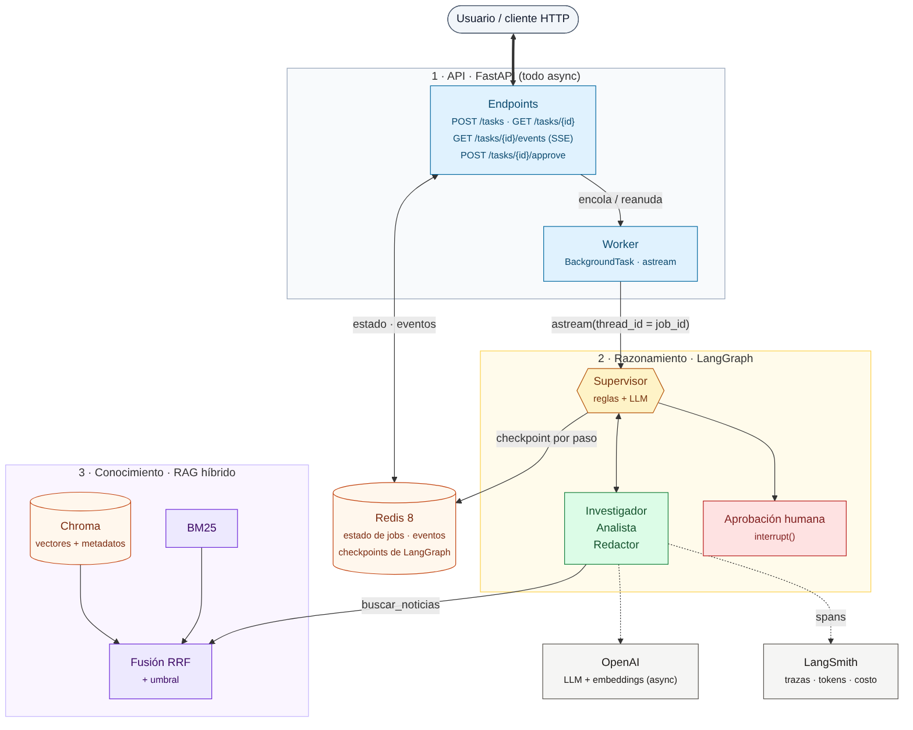

El sistema tiene tres capas. Cada una viene de módulos anteriores del curso y fue refactorizada a async:

| Capa | Archivos | Origen |
|---|---|---|
| **API y worker** | `app/main.py`, `app/api/*`, `app/worker.py`, `app/jobs.py` | Módulo 7 (Pre-entrega 7) |
| **Razonamiento** | `app/graph.py`, `app/agents/*`, `app/hitl.py`, `app/state.py` | Módulos 5 y 6 (Pre-entrega 6) |
| **Conocimiento** | `app/rag/*`, `data/corpus/` | Módulos 3 y 4 (Pre-entrega 3) |
| **Modelos y configuración** | `app/llm.py`, `app/config.py` | Módulos 1 y 2 |
| **Trazabilidad** | `app/observability.py` + middleware de logs | Módulo 7 |

---

## 3. El grafo de agentes

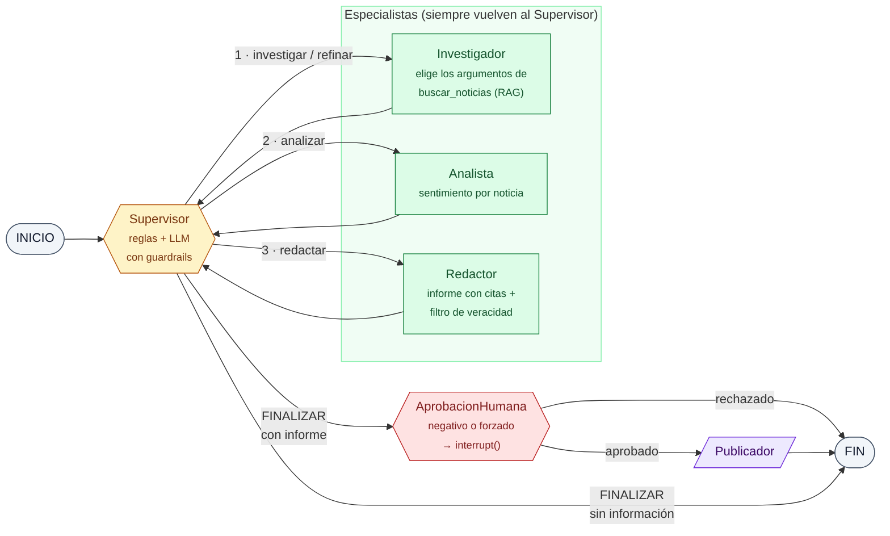

**Cómo decide el Supervisor.** Combina reglas en código y un LLM.

1. **Transiciones obligatorias (código).** No requieren criterio:
   - sin investigación → Investigador;
   - búsqueda con 0 resultados → Investigador, que refina hasta `MAX_INTENTOS_INVESTIGACION`;
   - noticias sin analizar → Analista;
   - análisis sin informe → Redactor;
   - informe "sin información" → FINALIZAR.

   Que no dependan del LLM es una lección de la Pre-entrega 6: un LLM real llegó a malinterpretar una regla así y entró en un bucle.
2. **Decisión de criterio (LLM con salida estructurada `DecisionSupervisor`).** Con el informe escrito, ¿alcanza (FINALIZAR) o conviene una nueva búsqueda? Ejemplos de motivos para volver a buscar: una sola fuente, citas descartadas, noticias que no tratan el tema.
3. **Guardrails.** El LLM no puede volver a un agente que ya actuó ni superar el máximo de investigaciones, y hay un tope de `MAX_PASOS`. Cada decisión queda con su razón en la bitácora `decisiones`, visible en la API, en los eventos y en las trazas.

**Qué hace cada especialista:**

| Agente | Usa el LLM para | Validación / defensa |
|---|---|---|
| **Investigador** | Elegir los argumentos de su herramienta `buscar_noticias` (reformular la consulta, sinónimos, etiquetas), con `tool_choice` forzado: **una sola llamada**. | Los argumentos se validan con `ParametrosBusqueda` (Pydantic). Si son inválidos, se usa un plan B. Los filtros del usuario se imponen siempre. |
| **Analista** | Clasificar el sentimiento de cada noticia (cadena LCEL + `with_structured_output(AnalisisLLM)` + `.with_retry()`). | Se descartan análisis de noticias que no se le pasaron. El promedio y el sentimiento general se calculan en código. |
| **Redactor** | Escribir el informe con hallazgos citados (`InformeLLM`). | **Filtro de veracidad:** se eliminan las citas a noticias no recuperadas y los hallazgos que quedan sin ninguna cita. Lo descartado se cuenta en el informe. |

La imagen siguiente es el diagrama que genera LangGraph a partir del grafo compilado, con `get_graph().draw_mermaid()`. Confirma que el diagrama de arriba refleja el código real:

<details><summary>Ver el grafo generado por LangGraph</summary>

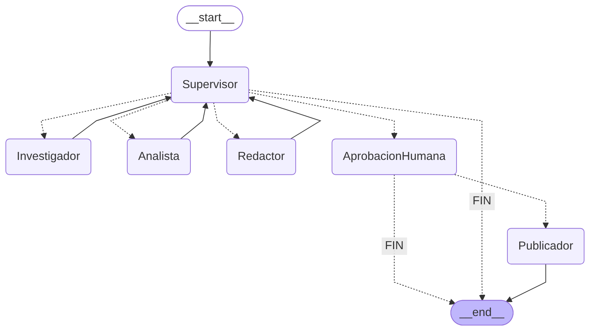
</details>

---

## 4. La capa de conocimiento (RAG híbrido)

<p align="center">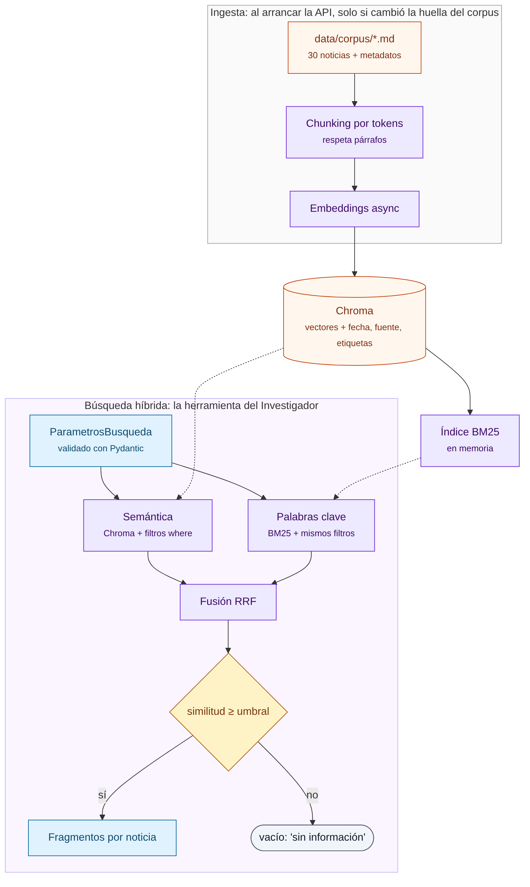</p>

**Ingesta (`app/rag/ingesta.py`).** Se ejecuta al arrancar la API y es **idempotente**. Calcula una huella del corpus y de la configuración de indexado (modelo de embeddings, tamaño de chunk). Solo genera embeddings si esa huella cambió, así que un reinicio no vuelve a pagar embeddings.

**Chunking por tokens.** Respeta párrafos: junta párrafos completos hasta llenar `RAG_CHUNK_TOKENS`, y corta en ventanas con solapamiento solo los párrafos que no entran. Cada chunk lleva el titular adelante, para que conserve contexto aunque se recupere solo.

**Búsqueda híbrida (`app/rag/recuperador.py`)**, paso a paso:

1. **Semántica.** Embedding asíncrono de la consulta y búsqueda en Chroma. Los filtros de fecha y fuente se aplican **en la base**, con la cláusula `where`.
2. **Palabras clave.** BM25 en memoria sobre los mismos chunks, con los mismos filtros. Normaliza tildes, palabras vacías y plurales.
3. **Fusión RRF** (Reciprocal Rank Fusion): `Σ 1/(60 + posición)`. Premia lo que aparece arriba en los dos rankings, sin comparar escalas distintas. Es el re-ranking.
4. **Umbral de relevancia.** Se descarta lo que no alcanza `RAG_UMBRAL_SIMILITUD`. Es la primera barrera contra alucinaciones.
5. **Agrupado por noticia.** Devuelve un `Fragmento` por noticia, con los puntajes de cada método para poder auditar el ranking.

La búsqueda también se puede consultar directamente, sin agentes, con `POST /conocimiento/buscar`.

---

## 5. Persistencia y Human-in-the-loop

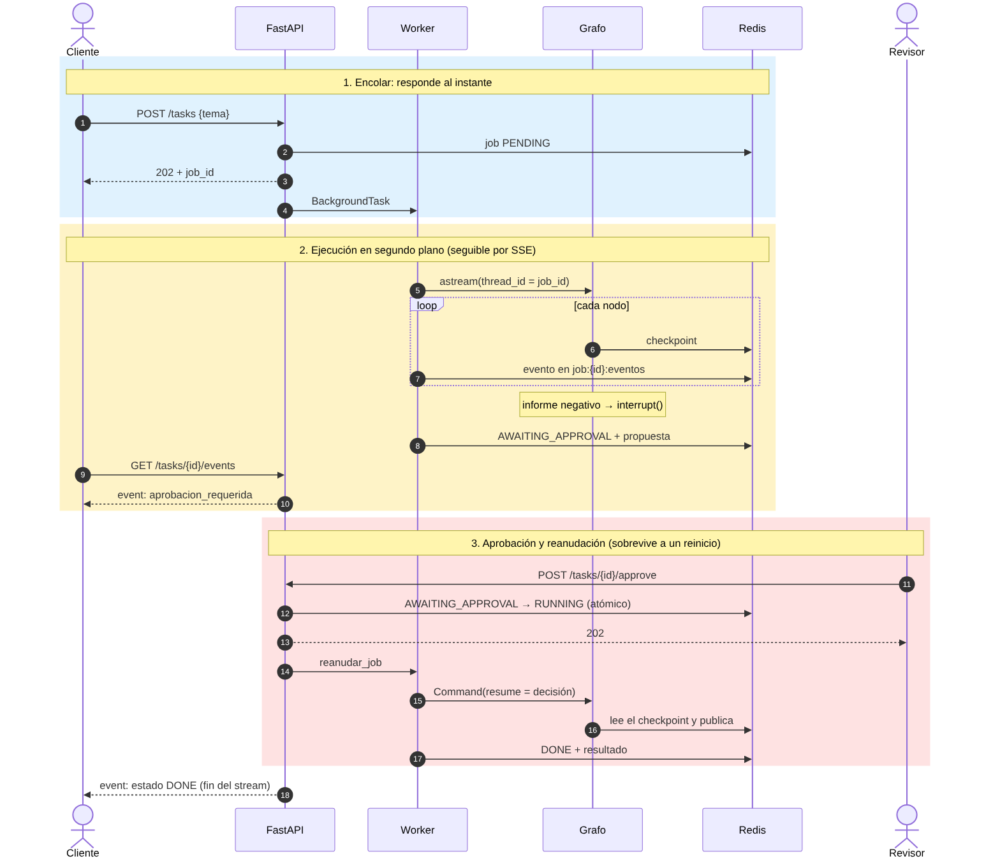

En Redis 8 se guardan cuatro tipos de datos:

| Clave | Contenido | Escribe |
|---|---|---|
| `checkpoint:*` | Estado del grafo después de **cada nodo**, por `thread_id = job_id` (vence a las 24 h) | `AsyncRedisSaver` (checkpointer de LangGraph) |
| `job:{id}` | Estado del job que ve el cliente (vence a los 7 días) | `JobStore` |
| `job:{id}:eventos` | Redis Stream con un evento por nodo y por cambio de estado | `JobStore` (lo consume el endpoint SSE) |
| `reportes:publicados` | Los informes publicados (el efecto secundario) | nodo `Publicador` |

**Por qué un job pausado sobrevive a un reinicio.** Cuando el grafo llega a `interrupt()`, el checkpoint ya está en Redis. La aprobación reanuda el mismo `thread_id` con `Command(resume=decisión)`, y no importa si la API se reinició en el medio. Cómo probarlo: [sección 8](#prueba-de-persistencia-reiniciar-la-api-con-un-job-pausado).

**Jobs interrumpidos por un reinicio.** Los jobs corren como BackgroundTasks, que viven en la memoria del proceso. Si la API se cae a mitad de un job (un crash, un deploy, `docker compose kill api`), al volver a arrancar busca los jobs que quedaron en `PENDING`/`RUNNING` y **los retoma desde su último checkpoint** con `astream(None)`: no repite los nodos que ya terminaron ni vuelve a pagar esos tokens. El cliente ve un evento `recuperado` en el stream. Hay dos reglas para los casos borde:

- si un mismo job vuelve a tumbar el proceso, no se reintenta en bucle: queda `FAILED` con el motivo;
- si la aprobación humana llegó pero el proceso murió antes de reanudar, el grafo sigue en el `interrupt()`, así que se vuelve a pedir la aprobación.

**Aprobaciones simultáneas.** La transición `AWAITING_APPROVAL → RUNNING` es atómica (`WATCH/MULTI/EXEC`). Si llegan dos aprobaciones a la vez, solo una reanuda el grafo y la otra recibe **409**.

**Lista blanca del checkpointer.** El checkpointer solo reconstruye las clases propias declaradas en `TIPOS_SERIALIZABLES`, y en **los dos formatos** que usa Redis (msgpack y JSON). En la Pre-entrega 7 faltaba el formato JSON y los objetos volvían como `dict` al reanudar. Hoy lo cubre un test de regresión.

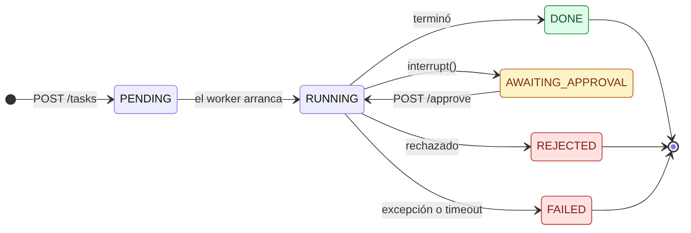

---

## 6. Puesta en marcha (un comando)

**Requisitos:**

- Docker Desktop.
- Una API key de **OpenAI**, que se usa para el LLM y los embeddings.
- Una API key de **LangSmith**, para las trazas. Se crea gratis en <https://smith.langchain.com>, en **Settings → API Keys**, y empieza con `lsv2_pt_`.

```bash
git clone <este-repo> && cd ai-news-intelligence
cp .env.example .env          # completar OPENAI_API_KEY y LANGSMITH_API_KEY
```

Después, **una sola instrucción**, según tu sistema:

| Windows (PowerShell) | Linux / macOS | Cualquier sistema |
|---|---|---|
| `.\run.ps1` | `./run.sh` | `docker compose up --build` |

Esto levanta **Redis 8 + Chroma + la API**. Al arrancar, la API indexa el corpus (solo la primera vez) y queda lista en <http://localhost:8000>. La documentación interactiva (Swagger) está en <http://localhost:8000/docs>. Los scripts `run.*` además verifican el `.env` y esperan a que `/health` responda.

> Si PowerShell bloquea el script: `powershell -ExecutionPolicy Bypass -File .\run.ps1`

Para verificar:

```bash
curl http://localhost:8000/health
# {"status":"ok","redis":true,"chroma":true,"indice_listo":true,"noticias_indexadas":30,
#  "observabilidad":{"plataforma":"langsmith","activo":true,"proyecto":"ai-news-intelligence","conexion":"ok"}}
```

**Problemas frecuentes:**

| Síntoma | Causa y solución |
|---|---|
| La API se detiene con `OpenAI rechazó OPENAI_API_KEY (vencida, revocada o inválida)` | La key de OpenAI no sirve. Generá una nueva en <https://platform.openai.com/api-keys>, ponela en el `.env` y volvé a correr `.\run.ps1` / `./run.sh` (recrean el contenedor de la API). Si dice `RateLimitError` / `insufficient_quota`, falta saldo en la cuenta. |
| `unknown command 'FT.INFO'` al arrancar | El checkpointer necesita **Redis 8** (módulos de búsqueda y JSON). Usá la imagen `redis:8` del compose. |
| `/health` dice `"conexion": "rechazada"` o `"motivo": "...valor de ejemplo..."` | Falta la key real de LangSmith en el `.env`. |
| Cambié el `.env` y no toma los valores | Docker lee el `.env` al crear el contenedor: `docker compose up -d --force-recreate api` |
| No encuentra la imagen `chromadb/chroma:1.5.9` | Usá el tag más cercano de la serie 1.5 publicado en Docker Hub (tiene que coincidir con `chromadb-client` de `requirements.txt`). |

**Desarrollo sin Docker para la API.** Con Redis y Chroma en Docker:

```bash
docker compose up -d redis chroma
python -m venv .venv && source .venv/bin/activate      # Windows: .venv\Scripts\activate
pip install -r requirements-dev.txt
uvicorn app.main:app --reload --port 8000
```

---

## 7. Uso de la API

| Método | Ruta | Descripción |
|---|---|---|
| `POST` | `/tasks` | Encola un informe. **202** con `job_id` y links. Body: `SolicitudInforme` (`tema`, `fecha_desde`, `fecha_hasta`, `fuentes`, `forzar_aprobacion`). |
| `GET` | `/tasks/{id}` | Estado del job: `paso_actual`, bitácora de `decisiones`, `resultado` o `error`. |
| `GET` | `/tasks/{id}/events` | **Streaming SSE** del progreso, nodo por nodo. Soporta `Last-Event-ID` para reconectar. |
| `GET` | `/tasks/{id}/checkpoint` | Lo que el checkpointer tiene guardado de ese hilo: cantidad de checkpoints, siguiente nodo, si está pausado. |
| `POST` | `/tasks/{id}/approve` | Decisión humana (`aprobado`, `comentario`, `revisor`). **202**, o **409** si el job no espera aprobación. |
| `GET` | `/tasks` | Últimos jobs. |
| `POST` | `/conocimiento/buscar` | Búsqueda híbrida directa, con los puntajes de cada método. |
| `GET` | `/conocimiento` | Estado del índice: noticias, chunks, huella, umbral. |
| `GET` | `/reportes` | Informes publicados. |
| `GET` | `/health` | Estado de Redis, Chroma, el índice y LangSmith. |

Todas las entradas y salidas están tipadas con Pydantic; un body inválido devuelve **422**. Cada respuesta incluye un header `X-Request-ID` que también aparece en los logs.

**Ejemplo: un informe con aprobación humana.**

```bash
curl -X POST localhost:8000/tasks -H "Content-Type: application/json" \
     -d '{"tema": "incidentes de seguridad y fallas de agentes de IA"}'
# {"job_id":"…","status":"PENDING","links":{"estado":"/tasks/…","eventos":"/tasks/…/events",…}}

curl -N localhost:8000/tasks/<job_id>/events        # progreso en vivo
# event: nodo
# data: {"nodo": "Investigador", "consulta": "…", "noticias": ["N06","N05","N19"], …}
# event: aprobacion_requerida
# data: {"motivo": "El informe tiene sentimiento general NEGATIVO …"}

curl -X POST localhost:8000/tasks/<job_id>/approve -H "Content-Type: application/json" \
     -d '{"aprobado": true, "revisor": "rayo"}'
```

En PowerShell, `curl` es un alias de otro comando: usá `curl.exe` o directamente Swagger en `/docs`.

---

## 8. Pruebas del sistema y evidencia

| Script | Qué hace |
|---|---|
| `python scripts/demo_escenarios.py` | **Las 5 pruebas de punta a punta**, una por capacidad, siguiendo cada job por SSE. |
| `python scripts/carga_concurrente.py` | 5 peticiones **concurrentes**, con latencias p50/p95 del lado cliente. |
| `docker compose exec api python -m scripts.evaluar_rag` | Calidad de recuperación (Hit@5, Recall@5, MRR) de vectorial vs. BM25 vs. híbrido, y calibración del umbral. |

Los 5 escenarios de `demo_escenarios.py`:

| # | Escenario | Qué demuestra |
|---|---|---|
| 1 | Informe positivo (chips y hardware) | RAG + agentes + publicación sin pausa |
| 2 | Informe negativo (incidentes de seguridad) | Pausa HITL y aprobación por la API |
| 3 | Aprobación rechazada (privacidad) | Pausa HITL y rechazo: no se publica |
| 4 | Filtro por fecha (`fecha_desde`) | Metadatos aplicados en la base vectorial |
| 5 | Tema fuera de la base (fútbol) | Anti-alucinación: refina y responde "sin información" |

### Resultados con la API real (OpenAI + LangSmith)

#### Calidad del RAG y calibración del umbral

`docker compose exec api python -m scripts.evaluar_rag`, con `text-embedding-3-small`. Salida real:

```
Calidad de recuperación (12 preguntas de referencia, k=5)

método             Hit@5  Recall@5     MRR
vector              1.00      0.97    1.00
bm25                1.00      1.00    0.92
hibrido             1.00      0.97    1.00

Calibración del umbral de relevancia (similitud coseno máxima por pregunta)
  preguntas EN la base:    mín 0.490 | prom 0.598
  preguntas FUERA de base: máx 0.281 | prom 0.259
  -> Separación limpia. Umbral sugerido: 0.39 (actual RAG_UMBRAL_SIMILITUD=0.3)
```

Cómo leerlo:

- **Los tres métodos encuentran siempre una noticia correcta (Hit@5 = 1.00).** El vectorial ordena mejor (MRR 1.00 contra 0.92 de BM25) y BM25 no se pierde ninguna noticia esperada (Recall 1.00). El híbrido se queda con el orden del vectorial, y BM25 lo cubre cuando la consulta trae nombres propios o siglas (lo prueba `test_recuperador.py`).
- **El umbral separa sin superposición.** La pregunta de la base con la similitud más baja llega a 0.490, y la más alta de las de afuera, a 0.281. El umbral inicial (0.30) quedaba casi pegado a las de afuera: en la primera corrida, la búsqueda de "chips" trajo noticias de relleno. Se calibró en el punto medio, **0.39**, que ahora es el valor por defecto.

#### Las 5 pruebas de punta a punta

`python scripts/demo_escenarios.py` contra el sistema levantado con Docker Compose (gpt-4o-mini + `text-embedding-3-small`, LangSmith activo). Salida real, resumida:

```
[1] Informe positivo (sin pausa)
     🔎 Investigador: 'avances en chips, hardware eficiente, tecnología de semiconductores, ...' -> ['N07', 'N18', 'N28', 'N22', 'N12']
     ✍️  Redactor: 4 hallazgos, 0 citas descartadas
     🧭 [paso 4] Investigador: El informe se apoya en una sola fuente principal sobre el chip de Silicio Pampa ...
     🔎 Investigador: '... innovación en circuitos integrados, desarrollo de microchips para IA' -> ['N07', 'N18', 'N14', 'N22', 'N28']
     🧭 [paso 7] FINALIZAR: (guardrail) Sin más intentos de investigación. El LLM sugería: ...
[2] Informe negativo con aprobación humana
     ⏸  Pide aprobación: El informe tiene sentimiento general NEGATIVO (score promedio 0.2) ...
     ✅ Aprobado (HTTP 202)
[3] Aprobación humana rechazada
     ⏸  Pide aprobación: El informe tiene sentimiento general NEGATIVO (score promedio 0.0) ...
     ⛔ Rechazado (HTTP 202)
[4] Filtros de metadatos (fecha)
     🔎 Investigador: 'lanzamientos, nuevos modelos de lenguaje, ...' -> ['N17', 'N24', 'N29', 'N27', 'N26']
     ✅ todas las fuentes son desde 2026-05-01
[5] Tema fuera de la base (anti-alucinación)
     🔎 Investigador: 'resultados, campeonato de fútbol, ...' -> []
     🧭 [paso 2] Investigador: La búsqueda no encontró noticias relevantes: se reformula la consulta.
     🔎 Investigador: 'resultados, puntajes, clasificaciones, ... torneo de fútbol' -> []
     🧭 [paso 3] Analista: Sin noticias relevantes tras 2 intentos: se registra que no hay datos.

==============================================================================
✅ [1] Informe positivo (sin pausa)                 DONE        22.7 s
✅ [2] Informe negativo con aprobación humana       DONE        10.6 s
✅ [3] Aprobación humana rechazada                  REJECTED    10.4 s
✅ [4] Filtros de metadatos (fecha)                 DONE        10.1 s
✅ [5] Tema fuera de la base (anti-alucinación)     DONE         2.6 s
==============================================================================
```

Qué se ve:

- **El Supervisor usa criterio y los guardrails lo frenan.** En el escenario 1 el LLM juzgó que el informe dependía de una sola fuente y pidió otra búsqueda. Al pedir una tercera, el tope `MAX_INTENTOS_INVESTIGACION` cerró el flujo en código. El costo de ese criterio se ve en LangSmith: el doble de tokens y de tiempo que un informe sin refinamiento.
- **El HITL funciona en los dos sentidos.** El escenario 2 se aprobó y publicó. El 3 se rechazó y no publicó nada.
- **Los filtros del usuario se respetan.** En el escenario 4 todas las fuentes son de mayo de 2026 en adelante.
- **Sin datos no se inventa nada.** En el escenario 5 el sistema reformula una vez, admite que no hay información y no llama al LLM para redactar.

#### Carga concurrente

`python scripts/carga_concurrente.py`, 5 temas a la vez (uno pasa por aprobación humana). Salida real, resumida:

```
Tiempo total de la corrida: 20.12 s (la suma de las tareas sería 74.1 s)
Latencia de POST /tasks  -> máx 97.1 ms | p95 97.1 ms
Latencia extremo a extremo (cliente) -> p50 11.47 s | p95 20.12 s
```

- **La API no espera al LLM.** `POST /tasks` respondió siempre en menos de 100 ms, con 5 grafos corriendo.
- **Los jobs corren en paralelo.** La corrida tardó lo que el job más largo (20 s), no la suma (74 s).
- **El p95 lo marcan los informes con refinamiento.** Esos ~20 s son dos vueltas completas de Investigador → Analista → Redactor.

> Estas corridas se hicieron con el umbral inicial (`RAG_UMBRAL_SIMILITUD=0.30`), antes de calibrarlo. Con 0.39 se descartan las noticias de relleno que se ven en el escenario 1 (N18, N28); el resto del comportamiento no cambia.

### Prueba de persistencia: reiniciar la API con un job pausado

```bash
# 1. Crear un job que se pause (tema negativo) y esperar AWAITING_APPROVAL
curl -X POST localhost:8000/tasks -H "Content-Type: application/json" -d '{"tema":"violaciones a la privacidad"}'
# 2. Reiniciar la API (el proceso muere; Redis queda)
docker compose restart api
# 3. El hilo sigue en el checkpointer y el job se puede aprobar
curl localhost:8000/tasks/<job_id>/checkpoint      # "pausado_en_interrupt": true
curl -X POST localhost:8000/tasks/<job_id>/approve -H "Content-Type: application/json" -d '{"aprobado":true}'
curl localhost:8000/tasks/<job_id>                  # "status": "DONE"
```

### Prueba de caída: matar la API en medio de un job

Esta prueba nació de un problema real (ver [sección 10](#10-decisiones-técnicas)). Con la demo corriendo, se mata el proceso de la API con `SIGKILL` mientras el Analista trabaja, y se vuelve a levantar:

```bash
python scripts/demo_escenarios.py --solo 1      # en una terminal
docker compose kill api; docker compose up -d api   # en otra, durante el paso del Analista
```

Salida real (entorno de desarrollo, con LLM falso, un Analista que tarda 8 s a propósito y `kill -9` al proceso):

```
[1] Informe positivo (sin pausa)
     🧭 [paso 1] Investigador: Todavía no se investigó el tema.
     🔎 Investigador: 'avances en chips y hardware eficiente para IA' -> ['N07', 'N14']
     🧭 [paso 2] Analista: Hay resultados de búsqueda sin analizar.
     ⚠️  Se cortó la conexión con la API (RemoteProtocolError). Esperando a que vuelva para retomar...
     ♻️  La API se reinició: el job se retoma desde el checkpoint (en ['Analista'])
     📊 Analista: sentimiento positivo (score 0.85)
     🧭 [paso 3] Redactor: Hay análisis pero todavía no hay informe.
     ✍️  Redactor: 2 hallazgos, 0 citas descartadas
     🧭 [paso 4] FINALIZAR: Decisión guionada para el test.
     ✅ estado final DONE
```

El job retomó en el Analista: la búsqueda no se repitió. El script se reconectó al stream con `Last-Event-ID` y no perdió ni repitió eventos. En ese entorno el checkpointer persistente fue SQLite, porque el Redis local no trae los módulos de Redis 8. En Docker es `AsyncRedisSaver` y el mecanismo es el mismo.

### Verificación en el entorno de desarrollo (sin API keys)

Para validar la mecánica sin gastar en el LLM, se levantó la app real (`lifespan`, uvicorn, Redis y **Chroma real**), con LLM y embeddings falsos y checkpointer en memoria. La corrida se hizo con **Python 3.12** y con `chromadb-client`, el cliente que usa la imagen Docker. Salida real:

```
✅ [1] Informe positivo (sin pausa)                 DONE         0.1 s
✅ [2] Informe negativo con aprobación humana       DONE         0.1 s
✅ [3] Aprobación humana rechazada                  REJECTED     0.1 s
✅ [4] Filtros de metadatos (fecha)                 DONE         0.1 s
✅ [5] Tema fuera de la base (anti-alucinación)     DONE         0.1 s

Carga concurrente: Tiempo total de la corrida: 0.65 s (la suma de las tareas sería 2.6 s)
                   Latencia de POST /tasks -> máx 168.9 ms
```

---

## 9. Observabilidad

**Trazas (LangSmith).** Con `LANGSMITH_TRACING=true`, cada ejecución del grafo es un árbol de spans. En él aparecen cada nodo, cada llamada al LLM (con tokens y costo), la herramienta `buscar_noticias`, y las cadenas del Analista y del Redactor con nombres propios (`investigador.planificar_busqueda`, `analista.sentimiento`, `redactor.informe`, `supervisor.evaluar_informe`).

Cada ejecución lleva también:

- tags: `entrega-final` y la etapa;
- metadata: `job_id`, `thread_id`, modelo de LLM y de embeddings.

Con `metadata.thread_id`, LangSmith agrupa en un mismo **Thread** la ejecución inicial y la reanudación después de la aprobación.

**Validación al arrancar.** La API comprueba que la key exista, que no sea el valor de ejemplo y que LangSmith la acepte (con una consulta real). Si algo falla, apaga el tracing y `/health` explica por qué.

**Logs.** Formato uniforme. Cada request deja método, ruta, estado, duración y `X-Request-ID`, y cada paso del worker queda con su `job_id`. Para verlos: `./run.sh logs` o `.\run.ps1 logs`.

**Capturas del dashboard** (todas en [`screenshots/`](screenshots/README.md), con la descripción de cada una):

| Lista de trazas con latencia, tokens y costo | Un job completo en Waterfall (con refinamiento) |
|---|---|
| 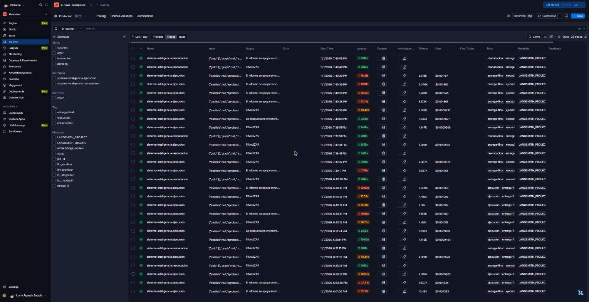 | 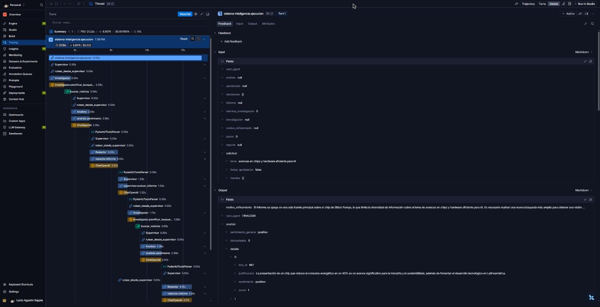 |
| **La herramienta RAG: lo que pidió el LLM y lo que devolvió** | **HITL: un Thread de 2 turnos (pausa y reanudación)** |
| 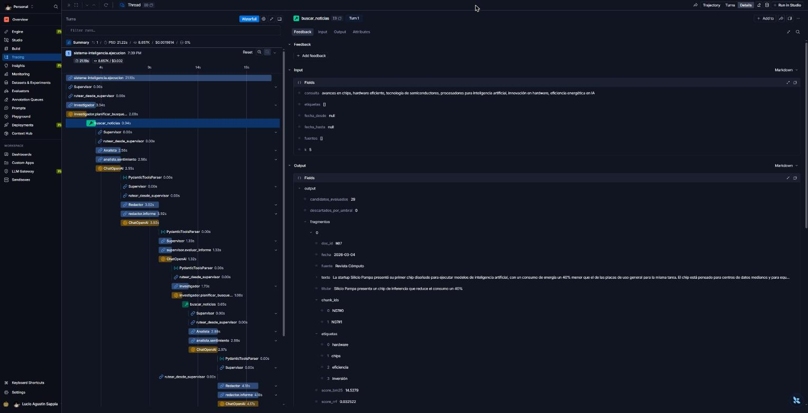 | 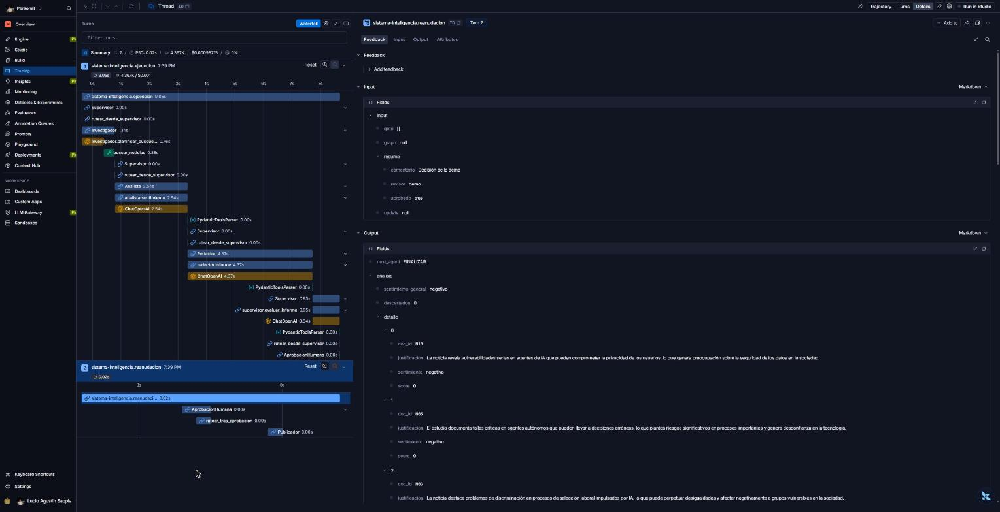 |
| **Tema fuera de la base: sin llamadas al LLM para redactar** | **Threads: P50/P99, tokens y costo por job** |
| 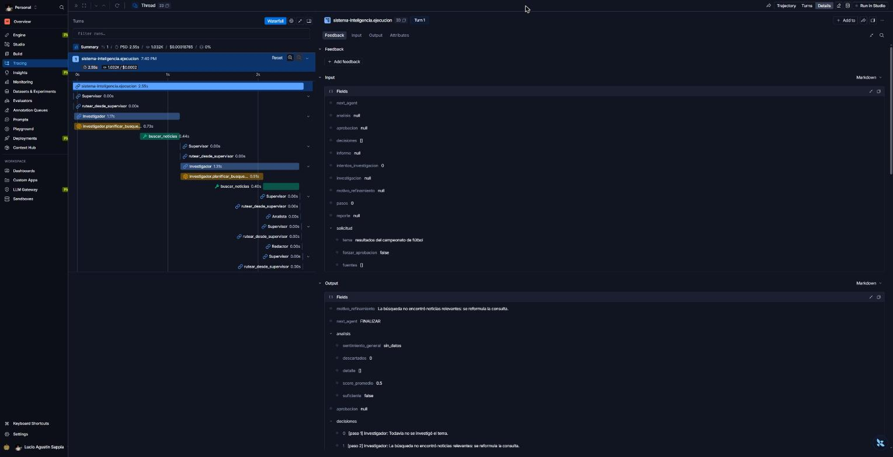 | 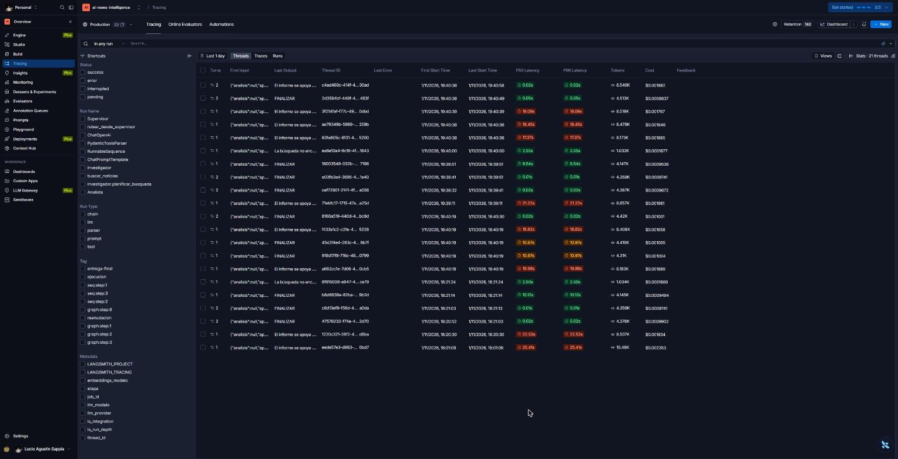 |

**Lectura del dashboard:**

| Caso | Latencia | Tokens | Costo (gpt-4o-mini) |
|---|---|---|---|
| Informe sin refinamiento (escenarios 2, 3 y 4) | ~10 s | ~4.4K | ~US$0.0010 |
| Informe con un refinamiento (escenario 1 y tres jobs de la carga) | ~17-21 s | ~8.5K | ~US$0.0019 |
| Reanudación tras la aprobación humana | 0.02 s | 0 | 0 |
| Tema fuera de la base (escenario 5) | 2.5 s | 1.0K | US$0.0002 |

- **El costo lo explica el criterio del Supervisor.** Un refinamiento duplica tokens y tiempo, por eso hay un tope de intentos. Afinar el umbral del RAG reduce los refinamientos innecesarios.
- **Pausar es gratis.** Gracias al checkpointer, la reanudación no repite ningún paso: va directo de `AprobacionHumana` a `Publicador`.
- **El "no sé" es barato.** Sin datos, el sistema no llama al LLM para analizar ni redactar.
- **Cada llamada se puede auditar.** El detalle de tokens por llamada, con el `job_id` que la vincula a la API, está en [`07_tokens_por_llamada.jpg`](screenshots/07_tokens_por_llamada.jpg).

---

## 10. Decisiones técnicas

**Todo async, verificado automáticamente.** Las llamadas a OpenAI usan `ainvoke` y `aembed_*` sobre el SDK asíncrono. Chroma usa `AsyncHttpClient`, Redis usa `redis.asyncio` y el checkpointer es `AsyncRedisSaver`. El disco y las librerías síncronas pasan por `asyncio.to_thread`.

`tests/test_auditoria_async.py` recorre el código con el AST de Python y **falla** si encuentra:

- `requests`;
- dentro de una función `async def`: `time.sleep`, `open()` o `Path.read_text()`;
- un endpoint que no sea `async def`.

**Una trampa encontrada en el camino.** `tiktoken` descarga su vocabulario con `requests.get` **síncrono** la primera vez que se usa. Por eso:

- se carga con `asyncio.to_thread`;
- la imagen Docker lo descarga en el build;
- si no hay red, hay un fallback por palabras.

**Pydantic en todas las fronteras:**

- la configuración (`Settings`, que falla al arrancar si un valor es inválido);
- la entrada y la salida de cada endpoint;
- los argumentos de la herramienta del agente (`args_schema=ParametrosBusqueda`);
- las salidas estructuradas de los LLM (`AnalisisLLM`, `InformeLLM`, `DecisionSupervisor`);
- la decisión humana al reanudar;
- los metadatos de cada noticia del corpus.

**Salida estructurada con `method="function_calling"`.** Es compatible con OpenAI y con Anthropic, y no choca con restricciones de Pydantic (`min_length`, `pattern`) que el modo `json_schema` de OpenAI no acepta. Si el LLM devuelve algo inválido, `.with_retry()` reintenta.

**Sin hard-coding.** Modelos, colección de Chroma, URLs, umbrales, timeouts y topes salen de variables de entorno (`app/config.py` y `.env.example`).

**Mejoras que vinieron de pre-entregas anteriores:**

| Problema que apareció | Solución en este proyecto |
|---|---|
| PE6: el LLM del Supervisor malinterpretó una regla y entró en un bucle | Las transiciones obligatorias se resuelven en código; el LLM solo decide lo que requiere criterio. |
| PE7: el 44 % de la latencia era una segunda llamada al LLM cuyo texto se descartaba | El Investigador hace **una** llamada con `tool_choice` forzado, y el Analista y el Redactor usan salida estructurada directa. |
| PE7: al reanudar desde Redis, los objetos volvían como `dict` | La lista blanca cubre los formatos msgpack **y JSON**, con un test de regresión que usa el código real de `AsyncRedisSaver`. |
| PE7: con el valor de ejemplo de la key, el tracing parecía activo y las trazas se perdían | La key se verifica contra LangSmith al arrancar. |
| **Entrega final, primera corrida real:** el stream SSE se cortaba a mitad del job y el cliente recibía `Server disconnected without sending a response` | Causa: redis-py 8 trae `socket_timeout=5` por defecto y el SSE espera eventos con `XREAD BLOCK` de 15 s. Cuando un nodo tardaba más de 5 s (el Analista con 10 noticias), la lectura fallaba. Ahora el timeout se configura (`REDIS_SOCKET_TIMEOUT_S`), `Settings` valida que sea mayor que la espera del SSE y el stream sobrevive a un error de Redis. Tiene tests de regresión con fakeredis y con un Redis real. |
| Entrega final: al refinar, el LLM pidió `k=10` y duplicó el prompt del Analista | `k` es un presupuesto del sistema (`RAG_K`), igual que los filtros del usuario: el LLM no puede ampliarlo. |
| Entrega final: si la API se reiniciaba, los jobs en curso quedaban en `RUNNING` para siempre | Al arrancar se retoman desde su último checkpoint ([sección 5](#5-persistencia-y-human-in-the-loop)). |

---

## 11. Tests automatizados

```bash
pip install -r requirements-dev.txt
pytest                      # 147 tests, ~6 s, sin API keys, sin Redis, sin Chroma, sin red
                            # (2 de integración se activan con CHROMA_TEST_HOST y REDIS_TEST_URL)
```

Los tests usan dobles de prueba en lugar de los servicios reales:

| En lugar de | Usan |
|---|---|
| El LLM | `ModeloGuionado`: responde como un LLM "obediente" según la herramienta o el esquema que se le pida, y puede simular argumentos inválidos o citas inventadas. |
| Los embeddings | `EmbeddingsHash`, deterministas. |
| Chroma | `AlmacenEnMemoria`, con la misma interfaz. |
| Redis | `fakeredis`. |
| El checkpointer | `InMemorySaver`, con el mismo serializador y la misma lista blanca. |

Toda la suite se corrió con **Python 3.12**, en un entorno limpio instalado solo desde `requirements-dev.txt`.

| Archivo | Qué cubre |
|---|---|
| `test_config.py` | Variables de entorno, validaciones que fallan al arrancar, claves que no se imprimen |
| `test_corpus.py` | Carga y validación de noticias, chunking por tokens, huella del corpus, normalización |
| `test_recuperador.py` | Fusión híbrida, filtros de fecha, fuente y etiquetas, umbral, BM25 con nombres propios, ingesta idempotente |
| `test_chroma_integracion.py` | Contra un **Chroma real**: ingesta y búsquedas idénticas al almacén en memoria (se activa con `CHROMA_TEST_HOST`) |
| `test_redis_integracion.py` | Contra un **Redis real**: la espera del SSE supera los 5 s sin cortarse (regresión del timeout de redis-py; se activa con `REDIS_TEST_URL`) |
| `test_agentes.py` | Filtros del usuario obligatorios, el LLM no puede ampliar `k`, plan B ante argumentos inválidos, análisis de noticias no recibidas, **filtro de veracidad**, cero llamadas al LLM cuando no hay datos |
| `test_graph.py` | Camino positivo, HITL aprobado y rechazado, forzar aprobación, tema fuera de la base, refinamiento pedido por el LLM, guardrails, tope de pasos, **reanudar con otra instancia del grafo**, hilos concurrentes |
| `test_checkpointer_redis.py` | El estado completo pasa por la conversión a JSON de `AsyncRedisSaver` y vuelve como objetos (regresión de la PE7) |
| `test_jobs.py` | Estado en Redis, TTL, **doble aprobación simultánea**, eventos en el stream |
| `test_worker.py` | DONE, AWAITING → DONE, REJECTED, **excepción → FAILED**, **timeout → FAILED**, eventos por nodo, 5 jobs concurrentes, **recuperación tras un reinicio** (retoma en el nodo correcto, sin bucles, aprobación perdida) |
| `test_api.py` | 202, 404, 409, 422, SSE (y que sobreviva a un error de Redis), checkpoint, búsqueda directa, health, `X-Request-ID`, modelo de respuesta en todos los endpoints |
| `test_no_bloqueante.py` | **Servidor uvicorn real**: 5 POST concurrentes no esperan al grafo y `/health` responde mientras corren |
| `test_observability.py` | Validación de la key de LangSmith (falta, valor de ejemplo, rechazada, sin red) |
| `test_auditoria_async.py` | **Auditoría estática**: ninguna llamada síncrona dentro de `async def`, todos los endpoints async |

Estilo: `ruff check` y `ruff format` sin observaciones (configuración en `pyproject.toml`).

---

## 12. Estructura del repositorio

```
ai-news-intelligence/
├── app/
│   ├── main.py              # FastAPI: lifespan (Redis, Chroma, ingesta, checkpointer), middleware
│   ├── config.py            # Settings (pydantic-settings): toda la configuración tipada
│   ├── llm.py               # Fábrica de LLM y embeddings async (timeouts, reintentos)
│   ├── state.py             # Estado del grafo + artefactos Pydantic + lista blanca del checkpointer
│   ├── graph.py             # Grafo LangGraph: Supervisor, nodos, guardrails, checkpointer de Redis
│   ├── hitl.py              # Regla de criticidad + nodo de aprobación con interrupt()
│   ├── worker.py            # Ejecuta/reanuda el grafo (astream), eventos, FAILED ante cualquier error
│   ├── jobs.py              # Estado de jobs y eventos en Redis (transición atómica, Streams)
│   ├── observability.py     # LangSmith (validación, metadata por job), logs
│   ├── dependencies.py      # Dependencias de FastAPI
│   ├── api/                 # Routers: tareas, aprobacion, conocimiento, sistema
│   ├── agents/              # investigador.py · analista.py · redactor.py
│   └── rag/                 # schemas · texto · corpus · almacen · recuperador · ingesta
├── data/corpus/             # 30 noticias ficticias (Markdown + metadatos)
├── scripts/                 # demo_escenarios · carga_concurrente · evaluar_rag
├── tests/                   # 147 tests (fakes.py, conftest.py y 14 archivos de tests)
├── docs/diagramas/          # Diagramas (fuente .mmd + imagen .png)
├── screenshots/             # Capturas de LangSmith
├── Dockerfile · docker-compose.yml · run.sh · run.ps1
├── pyproject.toml · requirements.txt · requirements-dev.txt · .env.example · pytest.ini
└── README.md
```

---

## 13. Cumplimiento de la rúbrica

| Criterio (peso) | Cómo se cumple | Dónde |
|---|---|---|
| **Arquitectura y coherencia (30%)** | Un flujo unificado: API → worker → grafo con Supervisor → especialistas. El RAG es la herramienta del Investigador, el Analista y el Redactor trabajan sobre lo recuperado, y el HITL va antes del efecto secundario. Capas separadas, con dependencias inyectadas. | `app/graph.py`, `app/agents/*`, `app/rag/*`, `app/api/*`; secciones 2 a 5 |
| **Robustez técnica: async y Pydantic (25%)** | Todo async (SDK async de OpenAI, `AsyncHttpClient` de Chroma, `redis.asyncio`, `AsyncRedisSaver`, `to_thread` para I/O síncrona), **auditado por un test**. Pydantic en configuración, API, herramientas, salidas de LLM, decisión humana y corpus. Errores → FAILED, timeouts, reintentos, 409 atómico. | `tests/test_auditoria_async.py`, `test_no_bloqueante.py`, `app/state.py`, `app/rag/schemas.py` |
| **Persistencia y observabilidad (20%)** | `AsyncRedisSaver` con checkpoint por paso, reanudación tras reinicio, TTL y lista blanca. Trazas en LangSmith con metadata por job y Threads, verificación de la key, logs con request id, eventos SSE. | `app/graph.py`, `app/observability.py`, `screenshots/`, `test_checkpointer_redis.py` |
| **Documentación y despliegue (15%)** | Este README (arquitectura en el primer párrafo, 5 diagramas + el generado por LangGraph, decisiones, troubleshooting). Un comando: `run.ps1`, `run.sh` o `docker compose up --build`, con ingesta automática. | `README.md`, `docs/diagramas/`, `docker-compose.yml`, `run.*` |
| **Entorno y estándares (10%)** | Python 3.12 (`requires-python`, imagen `python:3.12-slim`, suite corrida en 3.12). Dependencias fijadas, configuración solo por variables de entorno, `ruff` sin observaciones, imagen sin root. | `pyproject.toml`, `requirements*.txt`, `.env.example`, `Dockerfile` |

**Checklist final de la consigna:**

- [x] Clonar en limpio y arrancar con un comando.
- [x] Sin secretos en el código ni en el historial (`.env` en `.gitignore`).
- [x] Diagrama del grafo en el README.
- [x] Python 3.12 declarado y respetado.
- [ ] Capturas de trazas en el repo (`screenshots/`).
- [ ] Salida real de las 5 pruebas con OpenAI.

---

## 14. Limitaciones conocidas

- **Corpus chico y ficticio.** Son 30 noticias. La arquitectura no depende del tamaño, pero BM25 en memoria es por proceso; con millones de documentos habría que usar un motor con búsqueda full-text (por ejemplo, Redis Query Engine o Elasticsearch).
- **Worker en proceso.** Se usan BackgroundTasks de FastAPI: una sola instancia de la API ejecuta sus jobs. Si el proceso se cae, al volver retoma los jobs desde su checkpoint; con varias instancias, esa recuperación necesitaría un lock por job. Para escalar horizontalmente, el paso siguiente es un worker separado que lea de una cola en Redis (Arq o Celery). El estado y los checkpoints ya viven en Redis, así que no cambiarían.
- **Umbral de relevancia.** Depende del modelo de embeddings. Se calibra con `scripts/evaluar_rag.py` y se ajusta en `RAG_UMBRAL_SIMILITUD`.
- **Sentimiento.** Lo decide el LLM noticia por noticia. El agregado y la regla de criticidad son reproducibles, pero la clasificación individual puede variar entre corridas.
